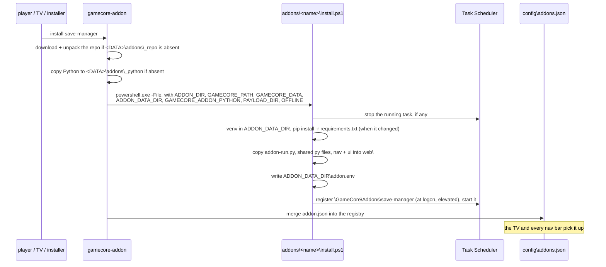

# 2 — Lifecycle & registry

## The CLI

`gamecore-addon` ships with the **core** (`install/bin/gamecore-addon`, a
Python script, and `gamecore-addon.cmd` for a prompt), not with this repo. The
backend runs it on its own interpreter for the Addons screen. Run by hand, it
needs an elevated prompt: registering a task does, and the installer's
`session.env`, where it reads the data root, is administrators only.

```
gamecore-addon install <name>    fetch the repo if absent, run install.ps1, register
gamecore-addon remove  <name>    run uninstall.ps1, drop from the registry
gamecore-addon update  [name]    stop every installed addon, fetch the repo again, reinstall them all
gamecore-addon list  [--json]    available (repo) vs installed (registry)
gamecore-addon auth-reset        new web password; every web session ends
```

There is no git on a Windows box: the repo arrives as GitHub's archive of
`main` (`codeload.github.com/p4v1c/gamecore-addons-windows/zip/refs/heads/main`),
unpacked to `<DATA>\addons\_repo`. **Services run straight from that folder**:
no copy, no build, no staging. `_repo` cannot collide with an addon (names
start with `[a-z0-9]`).

## The addons' own Python

The CLI copies the interpreter it runs on (the installation's
`python\tools`) to `<DATA>\addons\_python`, and each addon's venv is built on
that copy. Not on the code root's interpreter: the updater stops every process
whose executable lives in the code root and renames the folder, so an addon on
it would die, and block the swap, at every GameCore release. The copy is
refreshed by `update` when the core's Python version changed (every addon is
stopped then); a venv made on another version is rebuilt by `install.ps1`.

## Install sequence



Environment the CLI hands to the hooks:

| Variable | Meaning |
|---|---|
| `ADDON_DIR` | this addon's directory in the checkout |
| `GAMECORE_PATH` | the installation — read only |
| `GAMECORE_DATA` | the player's data — write here |
| `ADDON_DATA_DIR` | the addon's own corner, created before the hook runs |
| `GAMECORE_ADDON_API` | the api version the manager speaks (`1`) |
| `GAMECORE_ADDON_PYTHON` | the interpreter to build the venv on (install only) |
| `USER_NAME` | the console user (`DOMAIN\user`): the task runs as them |
| `GAMECORE_BACKEND_PORT` | where the core listens |
| `PAYLOAD_DIR` | where offline assets were unpacked |
| `OFFLINE` | `1` → install wheels from `PAYLOAD_DIR\wheels`, no PyPI |

**`install.ps1` must be idempotent.** `update` runs it again, which is what
refreshes the shared files, the venv and the task.

## The task

`Install-GcAddon` (`shared\windows\addon-hooks.ps1`) registers
`\GameCore\Addons\<name>`:

| Setting | Value | Why |
|---|---|---|
| trigger | at the console user's logon | the backend starts at the same moment, in the same session |
| principal | the console user, interactive, highest run level | elevated like the backend (owner's decision); the user's `%APPDATA%` is the emulators' |
| action | `<ADDON_DATA_DIR>\venv\Scripts\pythonw.exe addon-run.py addon.env` | no console window over the TV |
| restart | 3 times, 1 min apart, on top of `addon-run.py`'s own loop | a hard crash of the interpreter itself |
| time limit | none | a server runs for the whole session |

Stopping the task ends the server: the venv's `pythonw.exe` starts the base
interpreter in a job that dies with it (checked on the real PC).

## The registry — `config\addons.json`

Written by the CLI from each `addon.json`. It lives in the **core's** data
`config\` directory, which no update touches.

Two endpoints serve it:

| Endpoint | Auth | Consumer |
|---|---|---|
| `GET /api/addons` | LAN: 403 | the TV's Addons screen |
| `GET /gc/addons` | none | the shared nav bar in every addon UI |

`/gc/addons` exists because the nav bar has to render *before* login state is
known — it is the one core payload Caddy proxies without auth.

The core's `routers/addons.py` runs the CLI for install/update/remove and never
manipulates addon files itself. That is why the registry stays consistent
whichever way the command was issued.

## Shared components

Each addon runs from its own directory with its own venv and **never imports
across the tree**. Sharing is therefore done by copy at install time, by
`Copy-GcAddonShared`:

| Path | What | Consumers |
|---|---|---|
| `shared/windows/addon-run.py` | the launcher the task runs | every addon |
| `shared/nav/gamecore-nav.js` + `.css` | the cross-addon nav bar | every `web` addon |
| `shared/ui/` | the shared look (tokens, icons, font) | every `web` addon |
| `shared/py/sfo.py` | PARAM.SFO reader (title, serial, version, category) | save-manager, rpcs3-manager |
| `shared/py/windows_dirs.py` | `%APPDATA%`, Documents (asked from the shell), portable exe folders | bios-manager, save-manager |

The Python files an addon wants are listed under `shared` in its `addon.json`;
`scripts/run-tests.py` stages the same files before the tests. The copies are
gitignored.

> **`shared/` is the only version to edit.** Changing
> `addons/save-manager/sfo.py` does nothing upstream and is overwritten on the
> next update. An addon run straight from a checkout without `install.ps1`
> will not find these files: run `python scripts/run-tests.py <addon>` once to
> stage them for development.

### The nav bar

`gamecore-nav.js` fetches `/gc/addons` (same origin) and renders a link per
installed `web` addon from its `path`. No addon knows another addon's port
— that is what makes four separate services feel like one site, and what lets
Caddy move them around.

## Updating

`gamecore-addon update` = run every installed addon's `uninstall.ps1` (their
servers hold the checkout and the Python copy), replace `_repo` with a fresh
archive, then run every `install.ps1` again, whatever addon was named: the
archive replaces the whole repo, and an addon left out would run new code
without its deploy step. Consequences:

- shared files are refreshed, the task rewritten, pip runs if
  `requirements.txt` changed;
- the old checkout is kept until the new one is in place, and a failed
  download restarts the addons as they were;
- **local edits in `_repo` are lost**: it is replaced wholesale.

`install` of a new addon does not refresh the repo while others run from it:
run `update` first to get an addon added to the repo since.

## Uninstall

`uninstall.ps1` stops the task and unregisters it. It deliberately does
**not** delete user data, the venv included: an addon's job is to manage the
PC's files, not to own them.
